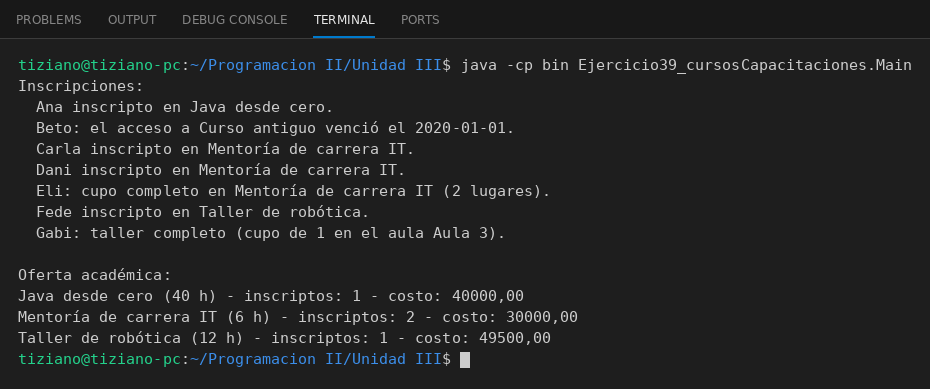

# Curso

Programación II - Unidad 3 - Ejercicio 39

## Consigna
Modelar una jerarquía de clases con herencia: una clase base y subclases que reutilizan código con `super` y sobrescriben métodos. Cursos con distintas modalidades.

## Lógica
- `Curso` con `inscribirAlumno` y `calcularCostoFinal`.
- `CursoGrabado` valida la fecha límite y aplica descuento; `MentoriaEnVivo` y `TallerPresencial` validan el cupo, y el taller suma un recargo.
- `Main` simula inscripciones, incluyendo rechazos.

## Ejecución

